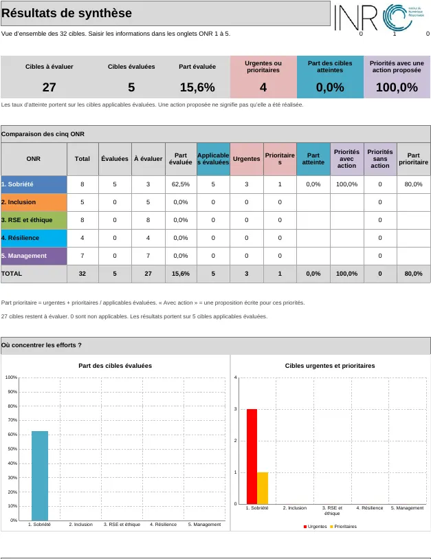

# Exemple commenté

Extrait du classeur `INR_GPC_ONR Exemple.xlsx` : une organisation fictive ayant renseigné une partie des 32 cibles. Il montre le niveau de détail attendu dans les colonnes texte, qui portent l'essentiel de la valeur de l'exercice.

{ loading=lazy }

Données complètes de cet exemple : [`data/gpc-onr-exemple.json`](../data/gpc-onr-exemple.json).

## ONR 1 : Sobriété

### Cible 1.1 : Prendre en compte toutes les étapes de la vie des équipements et des logiciels, de leur création à leur fin de vie, pour contribuer à la transition énergétique.

| | |
|---|---|
| **Importance** | 3 / 3 |
| **Niveau actuel** | 1 / 4 |
| **Compétences nécessaires** | 3 |
| **Niveau de priorité** | **Intervention urgente** |

**Avantages possibles et risques**

Avantages possibles : réduire les émissions de gaz à effet de serre de l’organisation et se préparer aux futures règles environnementales.  
Risque : payer plus cher à l’achat certains équipements conçus pour limiter leurs effets sur l’environnement.

**Ce qui est déjà fait et ce qui justifie la note**

L’équipe Achats retient le prix d’achat comme seul critère de choix. Elle ne demande pas d’analyse du cycle de vie (ACV) aux fournisseurs dans les appels d’offres.

**Points forts et points faibles**

Point fort : la direction des achats souhaite adopter des pratiques plus durables.  
Point faible : l’équipe connaît peu les labels environnementaux des équipements informatiques.

**Actions proposées pour atteindre la cible**

Former l’équipe Achats aux critères du numérique responsable et aux labels TCO et EPEAT. Dans les prochains appels d’offres pour remplacer les serveurs, faire compter les critères environnementaux pour 15 % de la note.

### Cible 1.2 : Utiliser les équipements plus longtemps, même après la fin de leur amortissement, c’est-à-dire la période sur laquelle leur coût est réparti dans les comptes.

| | |
|---|---|
| **Importance** | 3 / 3 |
| **Niveau actuel** | 3 / 4 |
| **Compétences nécessaires** | 2 |
| **Niveau de priorité** | **Intervention à moyen terme** |

**Avantages possibles et risques**

Avantages possibles : réduire les dépenses d’achat de matériel et les déchets d’équipements électriques et électroniques (DEEE).

**Ce qui est déjà fait et ce qui justifie la note**

L’organisation a porté la durée de renouvellement des ordinateurs portables de trois à quatre ans l’année dernière. Elle dispose d’un contrat de maintenance.

**Points forts et points faibles**

Point fort : l’équipe technique peut réparer les équipements en interne.  
Point faible : certains utilisateurs demandent du matériel neuf pour son apparence.

**Actions proposées pour atteindre la cible**

Répartir le coût des équipements dans les comptes sur cinq ans au minimum : c’est la durée d’amortissement. Prévoir un stock de pièces détachées pour faciliter les réparations. Expliquer aux équipes comment garder leur ordinateur plus longtemps permet d’éviter des émissions de gaz à effet de serre.

### Cible 1.3 : Concevoir des services numériques qui limitent leurs effets sur l’environnement. Choisir des technologies qui contribuent aux Objectifs de développement durable (ODD).

| | |
|---|---|
| **Importance** | 3 / 3 |
| **Niveau actuel** | 2 / 4 |
| **Compétences nécessaires** | 2 |
| **Niveau de priorité** | **Intervention prioritaire** |

**Avantages possibles et risques**

Avantages possibles : réduire les effets des services sur l’environnement dès leur conception, faciliter leur utilisation et contribuer aux Objectifs de développement durable (ODD).  
Risques : accumuler des problèmes techniques non résolus ou créer des logiciels trop gourmands en ressources, qui obligent à remplacer le matériel plus tôt.

**Ce qui est déjà fait et ce qui justifie la note**

Les équipes valident les nouveaux services et sites web selon des critères fonctionnels, graphiques et financiers. Elles ne mesurent ni le poids des pages ni l’impact environnemental du code.

**Points forts et points faibles**

Point fort : les développeurs et les chefs de produit s’intéressent aux effets de leurs activités sur la société et l’environnement.  
Points faibles : ils connaissent peu les guides pour concevoir des services numériques moins polluants, comme le RGESN. Ils savent peu comment relier leurs projets aux ODD.

**Actions proposées pour atteindre la cible**

1. Former les équipes de conception, de développement et de gestion de projet à créer des services numériques qui limitent leurs effets sur l’environnement.  
  
2. Ajouter des exigences environnementales aux cahiers des charges, comme limiter le poids des images et réduire les demandes envoyées aux serveurs.  
  
3. Pour chaque nouveau projet, préciser à quels Objectifs de développement durable il contribue.

### Cible 1.7 : Réserver l’intelligence artificielle aux besoins qui la justifient et privilégier des solutions sobres en ressources.

| | |
|---|---|
| **Importance** | 3 / 3 |
| **Niveau actuel** | 1 / 4 |
| **Compétences nécessaires** | 2 |
| **Niveau de priorité** | **Intervention urgente** |

**Avantages possibles et risques**

Avantages possibles : maîtriser les coûts du matériel et des services d’IA, et réduire les émissions de gaz à effet de serre liées à leur entraînement et à leur utilisation.  
Risque : utiliser l’IA par effet de mode, sans besoin réel, et consommer davantage de ressources.

**Ce qui est déjà fait et ce qui justifie la note**

Les équipes métiers expérimentent plusieurs projets d’IA générative, dont des usages de ChatGPT. Elles ne mesurent pas leur impact énergétique et ne disposent pas de charte pour encadrer les besoins et les usages.

**Points forts et points faibles**

Point fort : l’équipe chargée des données et de l’informatique dispose de compétences techniques et souhaite explorer ces outils.  
Points faibles : elle connaît peu les méthodes pour mesurer et réduire la consommation de l’IA. Elle manque aussi de recul pour savoir quand l’IA est utile.

**Actions proposées pour atteindre la cible**

1. Vérifier le besoin avant chaque projet : faut-il de l’IA ou un outil informatique classique suffit-il ?  
  
2. Choisir de petits modèles spécialisés quand ils répondent au besoin.  
  
3. Former les développeurs et les spécialistes des données à réduire la consommation de l’IA, en améliorant le code et en évitant les calculs répétés.

### Cible 1.8 : Mesurer et réduire ce que consomme l’intelligence artificielle, pendant son entraînement comme pendant son utilisation.

| | |
|---|---|
| **Importance** | 3 / 3 |
| **Niveau actuel** | 1 / 4 |
| **Compétences nécessaires** | 2 |
| **Niveau de priorité** | **Intervention urgente** |

**Avantages possibles et risques**

Avantages possibles : maîtriser les coûts du matériel et des services d’IA, et réduire les émissions de gaz à effet de serre liées à leur entraînement et à leur utilisation.  
Risque : utiliser l’IA par effet de mode, sans besoin réel, et consommer davantage de ressources.

**Ce qui est déjà fait et ce qui justifie la note**

Les équipes métiers expérimentent plusieurs projets d’IA générative, dont des usages de ChatGPT. Elles ne mesurent pas leur impact énergétique et ne disposent pas de charte pour encadrer les besoins et les usages.

**Points forts et points faibles**

Point fort : l’équipe chargée des données et de l’informatique dispose de compétences techniques et souhaite explorer ces outils.  
Points faibles : elle connaît peu les méthodes pour mesurer et réduire la consommation de l’IA. Elle manque aussi de recul pour savoir quand l’IA est utile.

**Actions proposées pour atteindre la cible**

1. Vérifier le besoin avant chaque projet : faut-il de l’IA ou un outil informatique classique suffit-il ?  
  
2. Choisir de petits modèles spécialisés quand ils répondent au besoin.  
  
3. Former les développeurs et les spécialistes des données à réduire la consommation de l’IA, en améliorant le code et en évitant les calculs répétés.

## Ce que l'exemple montre

Les 5 cibles évaluées ont toutes une importance élevée (3). Celles dont le niveau actuel est faible (1 ou 2) remontent en intervention urgente ou prioritaire ; la cible 1.2, déjà bien engagée (niveau 3), ressort à moyen terme. Les cibles laissées vides ne sont pas classées : elles apparaissent en « non complétées » dans l'onglet de synthèse.

La colonne « Actions proposées pour atteindre la cible » est la sortie utile de l'exercice : elle transforme un diagnostic en plan de travail daté et attribuable.

{ loading=lazy width=627 }

## Voir aussi

- [Méthodologie](methodologie.md)
- [Référentiel des 32 cibles ONR](referentiel-onr.md)
