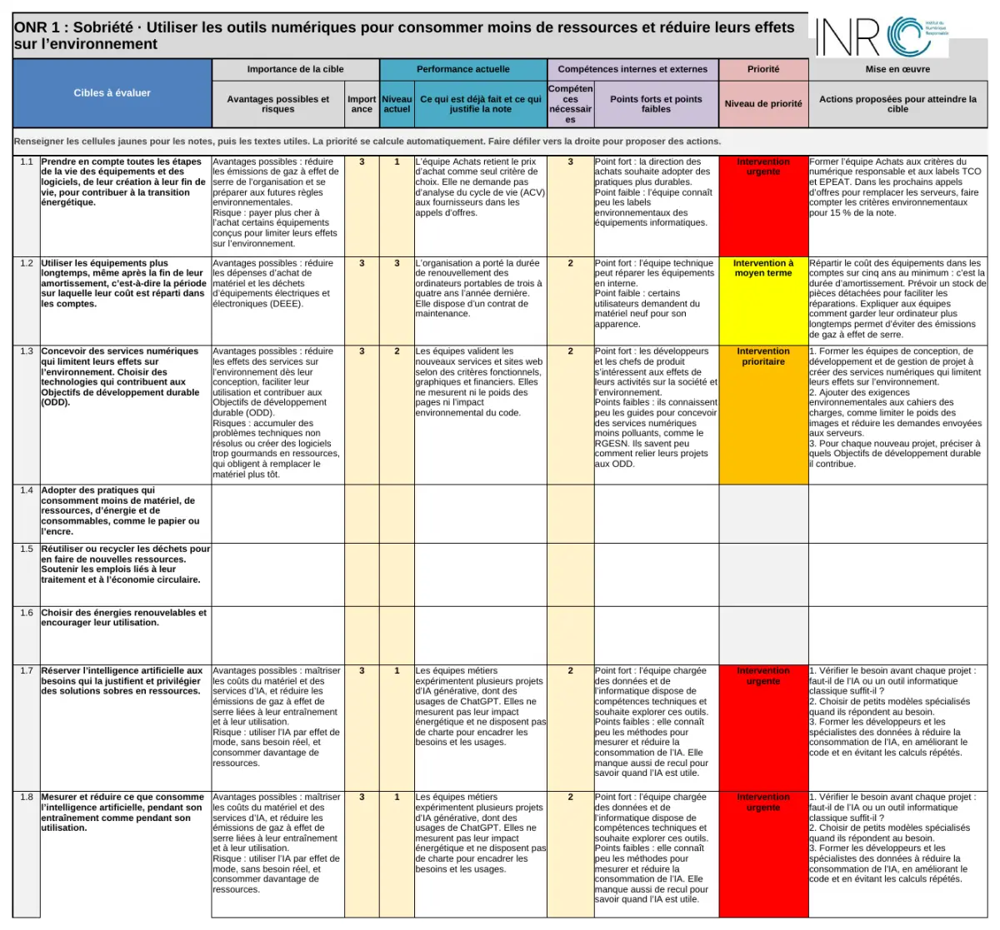

# GPC-ONR

**Grille de Priorisation des Cibles des Objectifs du Numérique Responsable.** Un outil libre d'auto-évaluation et de priorisation participative, publié par l'[Institut du Numérique Responsable](https://institutnr.org).

La GPC-ONR répond à une question simple et rarement traitée de front : parmi les 32 cibles des Objectifs du Numérique Responsable, **par lesquelles commencer ?** Elle croise, cible par cible, l'importance de l'enjeu pour l'organisation et sa performance actuelle, puis en déduit un ordre d'intervention.

!!! info "Ce que l'outil ne fait pas"
    Il ne délivre aucun score de conformité et aucun label. Il classe les cibles en sept niveaux d'intervention, pour servir de support à une décision collective.

[⬇ Télécharger la grille vierge](https://github.com/Institut-du-Numerique-Responsable/GPC-ONR/releases/latest/download/INR_GPC_ONR_Template.xlsx){ .md-button .md-button--primary }
[⬇ Télécharger l'exemple rempli](https://github.com/Institut-du-Numerique-Responsable/GPC-ONR/releases/latest/download/INR_GPC_ONR_Exemple.xlsx){ .md-button }

[▶ Voir la démonstration en une minute](presentation.html){ .md-button }

Un fichier Excel, rien à installer. Il s'ouvre avec Excel, LibreOffice Calc, Numbers ou Google Sheets, et ne contient aucune macro.

!!! abstract "Nouveau : versions alternatives"
    LaNum Pays Basque a adapté la grille aux publics qu'elle accompagne dans le projet européen NÉONUM : **[collectivités territoriales](secteurs/collectivites.md)** et **[enseignement supérieur et recherche](secteurs/enseignement-superieur.md)**. Elle a réécrit les 32 cibles dans le langage de chaque secteur, ajouté des cibles propres et relié chaque cible aux ODD. [Présentation des versions](secteurs/index.md).

## Démarrer

1. Ouvrez le classeur téléchargé ci-dessus. Aucune macro : rien à activer.
2. Renseignez l'onglet **Contexte** : organisation, participants, date. C'est ce qui rendra vos passages successifs comparables.
3. Parcourez les onglets **ONR 1** à **ONR 5**. Pour chaque cible, notez l'**importance** (0 à 3) et la **performance actuelle** (1 à 4), puis décrivez les avantages et les risques, ce qui est déjà fait, les points forts et faibles, et les actions proposées.
4. Lisez les onglets de résultats : les cibles urgentes et prioritaires forment votre plan de premier rang. Rejouez la grille plus tard pour mesurer la progression.

!!! tip "Seul puis à plusieurs"
    Vous pouvez remplir la grille seul pour un premier repérage, puis la rejouer en intelligence collective. La maturité se lit dans l'écart entre deux passages. Le **[classeur d'exemple](https://github.com/Institut-du-Numerique-Responsable/GPC-ONR/raw/main/INR_GPC_ONR%20Exemple.xlsx)** montre le niveau de détail attendu.

{ loading=lazy }

## Comment la priorité est calculée

Deux notes suffisent. Leur croisement donne le niveau d'intervention :

| Importance \ Niveau actuel | 1 : pas du tout atteinte | 2 : atteinte en partie | 3 : en voie d'être atteinte | 4 : atteinte |
|---|---|---|---|---|
| **3 : très importante** | 🔴 Urgente | 🟠 Prioritaire | 🟡 Moyen terme | 🟢 Consolidation |
| **2 : importante** | 🟠 Prioritaire | 🟡 Moyen terme | 🟢 Consolidation | ⚪ Non prioritaire |
| **1 : peu importante** | 🔵 Long terme | 🔵 Long terme | ⚪ Non prioritaire | ⚪ Non prioritaire |
| **0 : non applicable** | ⚫ Non pertinente | ⚫ Non pertinente | ⚫ Non pertinente | ⚫ Non pertinente |

Une cible laissée vide compte comme **non complétée**, jamais comme non prioritaire. Vous saurez ainsi ce qu'il reste à documenter.

## Les 5 axes

| Axe | Engagement | Thème | Cibles |
|---|---|---|---|
| **ONR 1 : Sobriété** | Utiliser les outils numériques pour consommer moins de ressources et réduire leurs effets sur l’environnement | Environnement | 8 |
| **ONR 2 : Inclusion** | Développer des services numériques durables que toutes et tous peuvent utiliser | Accessibilité | 5 |
| **ONR 3 : RSE** | Utiliser le numérique de façon éthique et responsable | Éthique | 8 |
| **ONR 4 : Résilience et stratégie** | Utiliser le numérique responsable pour aider l’organisation à faire face aux difficultés et à s’adapter | Résilience | 4 |
| **ONR 5 : Management** | Donner du sens au travail et préserver les personnes et les ressources nécessaires à nos activités | Valeurs | 7 |

Les cibles sont formulées en langage clair, avec un résumé **En bref** : voir **[les 32 cibles](referentiel-onr.md)**.

## Données ouvertes

Nous publions aussi le contenu des classeurs en JSON et CSV, réutilisable sans tableur.

```bash
# Lister les cibles de l'axe Sobriété, en langage clair
jq -r '.axes[] | select(.numero==1) | .cibles[] | "\(.code)  \(.explication)"' data/onr-referentiel.json
```

| Fichier | Contenu |
|---|---|
| [`onr-referentiel.json`](../data/onr-referentiel.json) | Les 5 axes et 32 cibles, structurés |
| [`onr-referentiel.csv`](../data/onr-referentiel.csv) | Même contenu, tabulaire |
| [`matrice-priorisation.json`](../data/matrice-priorisation.json) | Les 16 combinaisons et leur niveau |
| [`gpc-onr-exemple.json`](../data/gpc-onr-exemple.json) | Contenu textuel du classeur d'exemple |

## Contribuer

Corrections de libellés, améliorations de la méthode, traductions et retours d'usage sont les bienvenus. Voir le **[guide de contribution](https://github.com/Institut-du-Numerique-Responsable/GPC-ONR/blob/main/CONTRIBUTING.md)** et les **[contributeurs](contributeurs.md)**.
