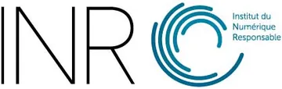
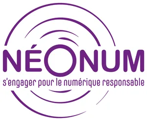

# Versions alternatives

{ height=44 style="vertical-align:middle" }
{ height=44 style="vertical-align:middle" }
{ height=64 style="vertical-align:middle" }

**LaNum Pays Basque** propose ces deux versions alternatives de la grille. Dans le cadre du projet européen **NÉONUM**, elle accompagne des collectivités territoriales et des établissements d'enseignement supérieur et de recherche, qui ne se reconnaissent pas toujours dans un outil pensé pour l'entreprise. Pour faciliter l'adoption de la GPC-ONR dans ces contextes, LaNum a reformulé les 32 cibles dans leur langage, ajouté des cibles propres à chaque secteur et relié chaque cible aux ODD. L'INR publie ces versions à côté de la grille commune.

[⬇ Version collectivités territoriales](https://github.com/Institut-du-Numerique-Responsable/GPC-ONR/raw/main/secteurs/collectivites/GPC-ONR_collectivites_Template.xlsx){ .md-button .md-button--primary }
[⬇ Version enseignement supérieur et recherche](https://github.com/Institut-du-Numerique-Responsable/GPC-ONR/raw/main/secteurs/enseignement-superieur/GPC-ONR_enseignement-superieur_Template.xlsx){ .md-button .md-button--primary }

## Deux versions

| | Collectivités territoriales | Enseignement supérieur et recherche |
|---|---|---|
| **Pour qui** | Communes, intercommunalités, départements, régions, syndicats et opérateurs publics de services numériques | Universités, écoles, organismes et laboratoires de recherche, CROUS |
| **Vocabulaire** | Habitants, agents, élus, téléservices, commande publique | Étudiants, enseignants, chercheurs, environnement numérique de travail, laboratoires |
| **Cadre de référence** | Loi REEN, RGAA, RGESN, RGPD, Code de la commande publique | Label DD&RS, plan de transition, formation à la transition écologique, science ouverte, RGAA, RGESN, RGPD |
| **Cibles propres au secteur** | Stratégie numérique responsable (loi REEN), territoire intelligent, illectronisme et médiation numérique, accessibilité des contenus et de l'accueil, données publiques ouvertes, encadrement de l'IA, mutualisation et continuité en cas de crise, civic tech et participation citoyenne | Sobriété du calcul de recherche, égalité d'accès des étudiants, science ouverte, plan de transition et DD&RS, formation des étudiants |
| **Détail** | [Les cibles](collectivites.md) | [Les cibles](enseignement-superieur.md) |

## Ce qui change par rapport à la grille commune

- **Les 32 cibles gardent leur code et leur sens.** Leur formulation et leurs exemples parlent le langage du secteur. Les résultats restent comparables avec la grille commune.
- **Des cibles propres au secteur** s'ajoutent : 8 pour les collectivités, 5 pour l'enseignement supérieur. Le classeur les regroupe dans la feuille « Cibles métier », avec leur propre calcul de priorité. Elles n'apparaissent pas dans les feuilles de résultats.
- **Chaque cible est reliée aux Objectifs de développement durable (ODD).** Beaucoup de collectivités et d'établissements suivent déjà les ODD, par exemple dans un label ou un rapport de développement durable. La grille part de ce qu'ils connaissent pour y relier le numérique responsable. Voir [Couverture des ODD](../couverture-odd.md).

La méthode ne change pas : même matrice importance × niveau actuel, mêmes niveaux d'intervention. Voir la [méthodologie](../methodologie.md).

## Une version de travail

Les reformulations et les cibles propres au secteur sont des propositions. Elles doivent être éprouvées avec des collectivités et des établissements. Pour faire un retour, [ouvrez une issue](https://github.com/Institut-du-Numerique-Responsable/GPC-ONR/issues).

Pour modifier une version ou en créer une pour un autre secteur, voir [`secteurs/README.md`](https://github.com/Institut-du-Numerique-Responsable/GPC-ONR/blob/main/secteurs/README.md).
